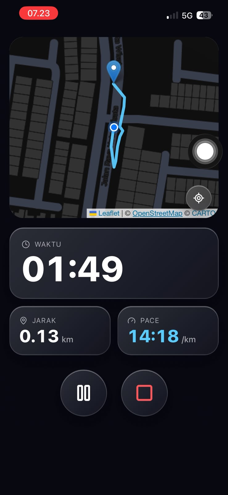

<div align="center">

# 🏃‍♂️ SpeedTrack

### Real-time run tracker with a liquid glass UI

Rekam waktu, jarak, pace, dan rute lari langsung dari browser. Tanpa login, tanpa API key, tinggal buka dan lari.

[](https://pelari-kalcer-app.vercel.app)
[](https://nextjs.org)
[](https://react.dev)
[](https://www.typescriptlang.org)
[](https://tailwindcss.com)
[](#-pwa)

<br />

<!-- Ganti dengan screenshot / GIF aplikasi -->


</div>

---

## ✨ Fitur

| | |
|---|---|
| ⏱️ **Statistik real-time** | Waktu, jarak (km), dan pace (menit/km) yang terus diperbarui |
| 🗺️ **Peta langsung** | Peta mengikuti posisi dan menggambar rute lari (OpenStreetMap, tanpa API key) |
| ⏯️ **Kontrol lengkap** | Start, Pause, Resume, Stop, Reset |
| 📊 **Ringkasan lari** | Total waktu, jarak, rata-rata pace, dan peta rute penuh |
| 📍 **Locate me** | Pusatkan peta ke posisimu kapan saja |
| 🔆 **Wake Lock** | Layar tetap menyala selama lari (dengan fallback) |
| 📲 **PWA** | Bisa di-install ke home screen, lengkap dengan banner khusus iOS |
| ⚠️ **Error handling** | Pesan jelas saat izin lokasi ditolak, tidak tersedia, atau timeout |

## 🎨 Desain

- **Mobile-first**, nyaman dipakai satu tangan
- Tema gelap dengan aksen **Azure `#0A84FF`**
- Efek **liquid glass** ala Apple: backdrop blur, gradient, dan inner highlight
- Fallback untuk browser tanpa `backdrop-filter`
- Menghormati `prefers-reduced-motion` dan fokus keyboard yang terlihat
- Angka statistik memakai `tabular-nums` agar tidak bergeser

## 🧠 Di Balik Layar

### Filter titik GPS berlapis
Setiap titik GPS melewati `shouldAcceptPoint` sebelum dihitung:

| Aturan | Tujuan |
|---|---|
| Akurasi `> 25 m` ditolak | Buang titik yang tidak presisi |
| Pergerakan `< 3 m` ditolak | Cegah GPS drift saat diam |
| Kecepatan implisit `> 25 km/jam` ditolak | Buang lonjakan tidak masuk akal |

### Perhitungan yang akurat
- **Jarak** dihitung dengan **formula Haversine**.
- **Pace** dihitung sendiri dari jarak dan waktu, tanpa bergantung `coords.speed` yang sering `null`.
- **Moving average 5 sampel** untuk smoothing agar angka tidak loncat.
- **Timer berbasis timestamp**: `Date.now() - startTime - totalPausedTime`, jadi tetap akurat walau `setInterval` telat.
- **Pause sungguhan**: GPS watch dan timer benar-benar berhenti.

### Arsitektur
- Logika dipisah dari UI lewat custom hooks (`useRunTracker`, `useWakeLock`) dan util murni (`lib/geo.ts`, `lib/format.ts`).
- Leaflet dimuat via `next/dynamic` dengan `ssr: false` agar aman di SSR.

## 🛠️ Tech Stack

- **Framework:** Next.js 16 (App Router), React 19, TypeScript
- **Styling:** Tailwind CSS v4 (konfigurasi via `@theme`)
- **Peta:** Leaflet + react-leaflet, tile OpenStreetMap
- **Ikon:** lucide-react
- **Web API:** Geolocation (`watchPosition`), Screen Wake Lock
- **Deploy:** Vercel

## 🚀 Menjalankan Lokal

```bash
# 1. Clone repo
git clone https://github.com/USERNAME/speedtrack.git
cd speedtrack

# 2. Install dependency
npm install

# 3. Jalankan dev server
npm run dev
```

Buka [http://localhost:3000](http://localhost:3000).

> 💡 **Tips:** Geolocation API butuh **HTTPS** di luar `localhost`. Untuk tes di HP, gunakan URL deploy Vercel atau tunnel HTTPS.

## 📲 PWA

Buka lewat HP, lalu:
- **Android (Chrome):** menu ⋮ → *Install app*
- **iOS (Safari):** tombol Share → *Add to Home Screen*

## 📁 Struktur Folder

```
app/
├── page.tsx
├── layout.tsx
├── globals.css
└── manifest.ts
components/
├── RunMap.tsx
├── StatCard.tsx
├── ControlButtons.tsx
├── SummaryView.tsx
├── BackgroundGlow.tsx
├── ServiceWorkerRegister.tsx
└── IosInstallBanner.tsx
hooks/
├── useRunTracker.ts
└── useWakeLock.ts
lib/
├── geo.ts        # haversine + filter GPS
└── format.ts     # formatTime, formatPace
public/
├── sw.js
└── icons/        # ikon PWA 192 & 512
```

## ⚠️ Batasan Saat Ini

Project ini dibuat sebagai portofolio dengan scope yang disengaja:

- Data **tidak disimpan** (hilang saat refresh)
- Tracking bisa berhenti saat tab di-background, terutama di iOS
- Tile OSM default punya [usage policy](https://operations.osmfoundation.org/policies/tiles/), kurang cocok untuk trafik besar

## 🗺️ Roadmap

- [ ] Simpan riwayat lari (localStorage / database)
- [ ] Login & profil
- [ ] Ekspor rute ke GPX
- [ ] Integrasi Strava
- [ ] Background tracking
- [ ] Leaderboard


---

<div align="center">

Dibuat dengan ☕ dan banyak langkah kaki oleh **[Dyala Muhammad](https://github.com/dyalamuhammad)**

⭐ Kalau suka, kasih bintang ya!

</div>
